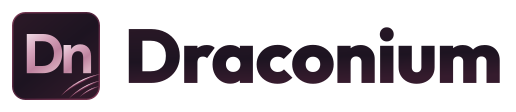

<p align="left">
  <picture>
    <source media="(prefers-color-scheme: dark)" srcset="assets/draconium-logo-dark.svg">
    <source media="(prefers-color-scheme: light)" srcset="assets/draconium-logo-light.svg">
    
  </picture>
</p>

**Chromium や OS 標準 WebView に依存しない、Servo 0.8.0 ベースの軽量 Rust デスクトップ WebView ホスト**

[English README](README.md) · [リリース一覧](https://github.com/watanuki-azuma/Draconium/releases) · [ホスト API 仕様](docs/host-api.md) · [クロスプラットフォーム対応](docs/cross-platform.md) · [ネイティブメディア](docs/media-gstreamer.md) · [Electron 機能対応表](docs/electron-mapping.md) · [ベンチマーク結果](measurements/README.md) · [ロードマップ](docs/roadmap.md)

Draconium は、[Servo 0.8.0](https://servo.org/)（Stylo / WebRender / SpiderMonkey）を単一プロセスの Rust ホストへ組み込み、標準の HTML / CSS / JavaScript で軽量なデスクトップアプリを構築するための基盤です。

Windows WebView2（`wry`）実装は比較基準として `probes/webview2/` に独立保持しており、Chromium へのフォールバックには使用しません。

---

## 主な特徴

- **独立レンダリングエンジン**: Servo 0.8.0（Stylo 0.23 / WebRender 0.70 / SpiderMonkey）を単一ポータブル実行ファイル（約 `112 MiB`）へ統合。`HostConfig::with_backdrop_filter` による GPU CSS `backdrop-filter` にも対応。
- **再利用可能な Rust ホストライブラリクレート**: 独立クレート [`crates/draconium-host`](crates/draconium-host/Cargo.toml) に `HostConfig` / `WindowConfig` / `HostHandler` / `Capabilities` / `EmbeddedAsset` / `run` を集約（詳細は [docs/host-api.md](docs/host-api.md)・最小サンプル [`examples/hello.rs`](crates/draconium-host/examples/hello.rs)）。
- **任意のネイティブメディア**: Servo 0.8.0 の `media-gstreamer` Cargo feature で GStreamer の音声／動画バックエンドを有効化できます。既定の `DummyBackend` は GStreamer DLL を含みません。詳細は [docs/media-gstreamer.md](docs/media-gstreamer.md)。
- **クロスプラットフォーム CI**: `main` への push と pull request では、Ubuntu・macOS・Windows で `scripts/verify-ci.py` を実行します。整形、Cargo メタデータ、プリロードを含む JavaScript 構文、Markdown リンク、単体テスト、OS 統合ハーネス（`-D warnings`）を検証します。ホストや Servo プローブを変更した場合は、Windows の `cargo check` で `host.rs`、`input.rs`、パッチ済み `servo-paint` も検証します。手動の Servo Build ワークフローは全 3 OS のリリースビルドと Windows でのホストライブラリのテスト実行に対応します。macOS / Linux の GUI 描画はデスクトップでの実行検証が今後必要です。
- **多層セキュリティ境界**:
  - `dn://app/` カスタムスキーム（ディレクトリトラバーサル防止、アプリ側供給の `EmbeddedAsset` 単一バイナリ埋め込みフォールバック、HTML / SVG / XML への厳格 `Content-Security-Policy` ヘッダ付与、`--csp-wasm` 対応）。
  - 初期オリジンに紐付く宣言的 [`Capabilities`](crates/draconium-host/src/policy.rs) ACL と、子ウィンドウ（`openChild` / `window.open`）への自動権限減衰。
  - 起動毎 128-bit セッショントークン認証と、初期オリジン限定で注入される再帰的 `Object.freeze` 済み `window.Draconium` プリロードブリッジ。
  - 外部遷移ガード（WebView ごとに初期オリジンへ限定：`dn://app/`・初期ディレクトリ配下の正規化済みローカル `file://`・明示指定 `--dev-url` ループバックのみ許可し、異オリジン遷移や UNC／シンボリックリンク脱出を拒否）。
- **ネイティブデスクトップ統合（Windows 実機検証済み・macOS / Linux `std` バックエンド実装済み）**:
  - 枠なしカスタムクローム（`drag`・8 方向 `dragResize`・最小化／最大化・フルスクリーン / F11・透過角丸シェル）、システムトレイ（`--tray`・Windows）、グローバルホットキー（`--hotkey`・Windows）、単一インスタンス引数転送（Windows `WM_COPYDATA` / macOS・Linux Unix ドメインソケット）。
  - ネイティブファイル／フォルダ選択・保存ダイアログ、ケーパビリティトークン付きファイル D&D（`dn:file-drop`）、リッチクリップボード（Text / HTML は全 OS、`CF_DIB` 画像は Windows、PNG 画像は macOS/Linux）、カスタム URI スキーム登録（Windows / Linux）、DPAPI `safeStorage`（Windows）、デスクトップ通知、自動起動（`HKCU` / `LaunchAgents` / XDG `.desktop`）、OS ライト／ダークテーマ追随、実行時プラットフォーム機能照会（`Draconium.window.getPlatform()`・詳細は [docs/cross-platform.md](docs/cross-platform.md)）。
  - PDF / HTML / PNG エクスポート、構造化 `.crash.json` クラッシュレポート、ループバック限定 Firefox DevTools RDP（`--devtools`）。

---

## 同梱ショーケースアプリ

1 つのバイナリ（`draconium`）から公開リファレンスアプリと比較画面を起動できます。

| フラグ | アプリ | 概要 |
| --- | --- | --- |
| `--workspace` *(既定)* | **Folio** | 外部ツール不要で単体動作するローカル Markdown ワークスペース。透過角丸カスタムクローム、Write / Split / Preview 切替、`.md` アトミック自動保存、ドラッグ＆ドロップ取込、HTML / PDF / PNG エクスポート、OS テーマ追随、オンデマンド 60fps Render Lab を内蔵。 |
| `--starter` | **Starter** | `HostHandler` と同期 `Draconium.invoke` / 非同期 `Draconium.invokeAsync`・テーマ追随の最小開発テンプレート。 |
| `--probe` | **比較プローブ** | Servo 0.8.0 と WebView2（`probes/webview2`）を同一条件で計測する共通比較画面（`ui/index.html`）。 |

主な共通オプション:
`--dn-assets` · `--workspace-dir <path>` · `--tray` · `--transparent` · `--opacity <0.1..1.0>` · `--hotkey <Accel>` · `--single-instance` · `--devtools` · `--dev-url http://127.0.0.1:<port>` · `--csp-wasm` · `--screenshot <out.png>`

---

## 組み込み API の例

`Cargo.toml` へ [`crates/draconium-host`](crates/draconium-host/Cargo.toml) を追加してアプリを構築できます（完全な最小サンプルは [`examples/hello.rs`](crates/draconium-host/examples/hello.rs)）。

```rust
use std::path::Path;
use draconium_host::{
    Capabilities, EmbeddedAsset, HostConfig, WindowConfig, resolve_app_url_from, run,
};

let (url, asset_root) = resolve_app_url_from(
    Path::new(env!("CARGO_MANIFEST_DIR")),
    dn_assets,
    dev_url.as_deref(),
    "workspace.html",
    "ui/workspace.html",
    "ui/workspace.html",
);

let caps = Capabilities::standard_desktop()
    .with_app_commands(["list_notes", "load_note", "save_note"]);

let config = HostConfig::new("Draconium Folio", url)
    .with_window(WindowConfig::custom_chrome(1240, 800))
    .with_asset_root(asset_root)
    .with_embedded_assets(EMBEDDED_ASSETS)
    .with_capabilities(caps);

run(config, WorkspaceApp::new(data_dir), None)?;
```

---

## ベンチマーク（Windows x64）

Windows 10 x64（Core i7-4790 / GTX 1070 Ti）にて共通比較画面（`ui/index.html`）を 3 回 × 30 秒アイドル計測した中央値です。詳細は [measurements/README.md](measurements/README.md) を参照してください。

| ランタイム | プロセス数 | Working Set（中央値） | Private Bytes（中央値） | アイドル CPU（1 コア %） | バイナリ / ランタイム |
| --- | ---: | ---: | ---: | ---: | --- |
| **Draconium (Servo 0.8.0)** | **1** | **112.32 MiB** | 261.27 MiB | **0.000%** | 111.94 MiB 単一実行ファイル |
| WebView2 (`wry 0.57.1`) | 7 | 314.75 MiB | 142.56 MiB | 0.411% | 1.00 MiB exe ＋ OS EdgeWebView2 Runtime |

---

## Windows でのビルドと実行

対象環境は **Windows x64**（MSVC）です。[Servo Book](https://book.servo.org/building/building.html) も参照してください。

### 必要環境

- Rust MSVC ツールチェーン（`rustup toolchain install stable-x86_64-pc-windows-msvc --profile minimal`）
- Visual Studio 2022 Build Tools（C++ x64/x86、ATL、Windows SDK）
- LLVM（`clang-cl` / `libclang.dll`）
- Python 3.11 以降（WindowsApps エイリアスではなく実体）

### ビルド・起動（Visual Studio 2022 Developer PowerShell）

```powershell
$env:PATH = 'C:\Program Files\LLVM\bin;' + $env:PATH
$env:LIBCLANG_PATH = 'C:\Program Files\LLVM\bin'
$env:CC = 'clang-cl'
$env:CXX = 'clang-cl'

# Servo 0.8.0 ホストのリリースビルド
cargo +stable-x86_64-pc-windows-msvc build --release --frozen --manifest-path probes/servo/Cargo.toml

# Folio を起動（既定）
.\probes\servo\target\release\draconium.exe --workspace --dn-assets

# 最小スターターを起動
.\probes\servo\target\release\draconium.exe --starter --dn-assets

# 比較基準（WebView2、要 WebView2 Runtime）
cargo +stable-x86_64-pc-windows-msvc run --release --locked --manifest-path probes/webview2/Cargo.toml
```

### 自動検証とポータブル配布

```powershell
# リリースビルド・単体テスト・Win32プローブ・E2Eセルフテスト・スクリーンショット・配布検証を一括実行
powershell -NoProfile -ExecutionPolicy Bypass -File scripts\verify-windows.ps1 -Build

# ポータブル配布フォルダーを作成（既定出力: dist\draconium）
powershell -NoProfile -ExecutionPolicy Bypass -File scripts\package.ps1

# ワークスペース UI のみを同梱して配布
powershell -NoProfile -ExecutionPolicy Bypass -File scripts\package.ps1 -App workspace -OutputDir dist\draconium-folio
```

---

## リポジトリ構成

```text
assets/                     Draconium アイコン SVG およびダーク／ライト用ロゴ SVG
crates/draconium-host/      独立した Servo 0.8.0 汎用デスクトップホストライブラリクレート
  src/lib.rs                公開ライブラリ API (HostConfig / WindowConfig / HostHandler / Capabilities / run)
  src/host.rs               イベントループ・Servo 統合・子ウィンドウ・キャプチャ基盤
  src/bridge.rs             プリロードブリッジ・トークン認証 IPC・Popover / ドラッグシム
  src/policy.rs             宣言的 Capabilities ACL・子ウィンドウ権限減衰
  src/protocol.rs           アセットパス・アプリ供給 EmbeddedAsset 検索・厳格 CSP
  src/dn_protocol.rs        dn://app/ 用の Servo プロトコルハンドラー
  src/unix_platform.rs      macOS / Linux ネイティブバックエンドと実行時 PlatformCapabilities 照会
  examples/hello.rs         draconium-host を直接利用する最小スタンドアロンサンプル
probes/servo/               draconium-host を利用するショーケースバイナリ (draconium)
  src/main.rs               Folio / Starter / Probe の CLI 配線と埋め込み UI アセット
  src/workspace.rs          Folio ローカル Markdown ワークスペース実装
  src/starter.rs            最小開発テンプレート実装
  vendor/servo-paint/       Servo 0.8.0 向け最小パッチ（120ms ホイール補間＋サブピクセル余剰正規化）
probes/webview2/            WebView2 比較バイナリ (draconium-webview2、wry 0.57.1)
ui/                         Servo / WebView2 共通比較画面（--probe）
scripts/                    Windows 検証 (verify-windows.ps1)・CI 検証 (verify-ci.py)・配布 (package.ps1)・計測 (measure.ps1)
docs/                       ホスト API 仕様・クロスプラットフォーム対応・メディア対応・Electron 対応表・比較手順・ロードマップ
measurements/               定量ベンチマーク結果（CSV / JSON）
```

### 上流 Servo パッチについて

`probes/servo/Cargo.toml` では、上流 `servo-paint 0.8.0` への最小パッチ 1 クレート（[`probes/servo/vendor/servo-paint`](probes/servo/vendor/servo-paint/README.draconium.md)）のみを適用し、行単位ホイール入力の 120ms 滑らか補間（`2^-10 px` 量子化）と非スクロール要素の `< 1.0 px` サブピクセル余剰正規化を実現しています。

---

## ライセンス

[Mozilla Public License 2.0 (MPL-2.0)](LICENSE) で公開しています。
比較基準の `probes/webview2/` は [wry](https://github.com/tauri-apps/wry) を使用しています。
`assets/` 内のロゴタイプには SIL Open Font License 1.1 の [Outfit](https://fonts.google.com/specimen/Outfit)（ExtraBold 800）をアウトライン化して使用しています。
