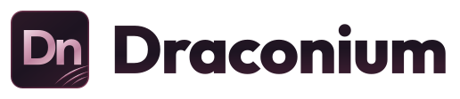

<p align="left">
  <picture>
    <source media="(prefers-color-scheme: dark)" srcset="assets/draconium-logo-dark.svg">
    <source media="(prefers-color-scheme: light)" srcset="assets/draconium-logo-light.svg">
    
  </picture>
</p>

**A lightweight, self-contained Rust desktop WebView host powered by Servo 0.8.0 — no Chromium or OS WebView runtime required.**

[日本語 README](README.ja.md) · [Releases](https://github.com/watanuki-azuma/Draconium/releases) · [Host API](docs/host-api.md) · [Cross-Platform](docs/cross-platform.md) · [Native Media](docs/media-gstreamer.md) · [Electron Feature Mapping](docs/electron-mapping.md) · [Benchmarks](measurements/README.md) · [Roadmap](docs/roadmap.md)

Draconium embeds [Servo 0.8.0](https://servo.org/) (Stylo, WebRender, SpiderMonkey) inside a single native Rust process so you can build desktop applications with standard HTML, CSS, and JavaScript without bundling Chromium or depending on platform WebView runtimes.

A separate Windows WebView2 crate (`probes/webview2`, using `wry`) is kept alongside the Servo host purely as a reproducible benchmark baseline — Draconium never falls back to Chromium.

---

## Features

- **Independent Web Engine**: Ships Servo 0.8.0 (Stylo 0.23, WebRender 0.70, SpiderMonkey) in a single portable executable (`~112 MiB` self-contained), with GPU CSS `backdrop-filter` enabled via `HostConfig::with_backdrop_filter`.
- **Reusable Rust Host Library Crate**: Standalone [`crates/draconium-host`](crates/draconium-host/Cargo.toml) crate exporting a builder-based API (`HostConfig`, `WindowConfig`, `HostHandler`, `Capabilities`, `EmbeddedAsset`, `run`) — see [docs/host-api.md](docs/host-api.md) and [`examples/hello.rs`](crates/draconium-host/examples/hello.rs).
- **Optional Native Media**: Servo 0.8.0's `media-gstreamer` Cargo feature enables GStreamer-backed audio/video; the default `DummyBackend` build includes no GStreamer runtime DLLs. See [docs/media-gstreamer.md](docs/media-gstreamer.md).
- **Cross-Platform CI**: Pushes to `main` and pull requests run `scripts/verify-ci.py` on Ubuntu, macOS, and Windows (formatting, metadata, JS syntax including the preload, Markdown links, standalone Rust tests, and a platform harness with `-D warnings`). Changes to the host or Servo probe also run a Windows Cargo check that covers `host.rs`, `input.rs`, and the patched `servo-paint` crate. The manually dispatched Servo Build workflow can build releases on all three platforms and runs the host library tests on Windows. Live macOS/Linux GUI rendering still awaits desktop runs.
- **Layered Security Boundaries**:
  - Custom `dn://app/` protocol with path-traversal protection, caller-supplied `EmbeddedAsset` (`include_bytes!`) fallback, and strict `Content-Security-Policy` headers on HTML, SVG, and XML (`--csp-wasm` optional).
  - Origin-bound declarative [`Capabilities`](crates/draconium-host/src/policy.rs) ACLs with automatic privilege attenuation for child windows (`openChild` / `window.open`).
  - Per-launch 128-bit session-token authentication and recursively `Object.freeze`'d `window.Draconium` preload bridge restricted to the initial app origin.
  - Navigation locked strictly per WebView to its initial origin (`dn://app/`, configured loopback `--dev-url`, or canonically contained same-directory local `file://`; cross-origin transitions and UNC/symlink escapes rejected).
- **Native Desktop Integration (Windows verified, macOS & Linux `std` backends)**:
  - Frameless custom chrome (`drag`, 8-edge `dragResize`, minimize, maximize, fullscreen / F11, rounded alpha surface), system tray (`--tray`, Windows), global hotkeys (`--hotkey`, Windows), and single-instance argument forwarding (`WM_COPYDATA` on Windows, Unix domain sockets on macOS/Linux).
  - Native file/folder pickers & save dialogs, capability-scoped drag-and-drop file bridge (`dn:file-drop`), rich clipboard (text & HTML cross-platform, `CF_DIB` images on Windows, PNG images on macOS/Linux), `customUriScheme` registration on Windows/Linux, DPAPI `safeStorage` (Windows), desktop notifications, autostart (`HKCU` / `LaunchAgents` / XDG `.desktop`), system Light/Dark theme sync, and runtime capability introspection (`Draconium.window.getPlatform()` — see [docs/cross-platform.md](docs/cross-platform.md)).
  - Built-in PDF / HTML / PNG export, structured `.crash.json` crash reports, and loopback Firefox DevTools RDP (`--devtools`).

---

## Included Showcase Applications

A single `draconium` binary includes two public reference apps plus the comparison baseline:

| Flag | Application | Description |
| --- | --- | --- |
| `--workspace` *(default)* | **Folio** | Standalone local-first Markdown workspace with custom frameless rounded chrome, live split preview, atomic `.md` persistence, drag-and-drop file import, native HTML/PDF/PNG export, OS theme sync, and an on-demand 60-frame Render Lab. |
| `--starter` | **Starter** | Minimal developer template demonstrating `HostHandler`, sync `Draconium.invoke`, non-blocking `Draconium.invokeAsync`, and OS theme synchronization. |
| `--probe` | **Comparison Probe** | Shared benchmark page (`ui/index.html`) used to measure Draconium (Servo 0.8.0) against WebView2 (`probes/webview2`). |

Common CLI flags:
`--dn-assets` · `--workspace-dir <path>` · `--tray` · `--transparent` · `--opacity <0.1..1.0>` · `--hotkey <Accel>` · `--single-instance` · `--devtools` · `--dev-url http://127.0.0.1:<port>` · `--csp-wasm` · `--screenshot <out.png>`

---

## Embedding API Example

Add [`crates/draconium-host`](crates/draconium-host/Cargo.toml) to your `Cargo.toml` (see [`examples/hello.rs`](crates/draconium-host/examples/hello.rs) for a complete runnable app):

```rust
use std::path::Path;
use draconium_host::{
    Capabilities, EmbeddedAsset, HostConfig, WindowConfig, resolve_app_url_from, run,
};

let (url, asset_root) = resolve_app_url_from(
    Path::new(env!("CARGO_MANIFEST_DIR")),
    dn_assets,
    dev_url.as_deref(),
    "workspace.html",
    "ui/workspace.html",
    "ui/workspace.html",
);

let caps = Capabilities::standard_desktop()
    .with_app_commands(["list_notes", "load_note", "save_note"]);

let config = HostConfig::new("Draconium Folio", url)
    .with_window(WindowConfig::custom_chrome(1240, 800))
    .with_asset_root(asset_root)
    .with_embedded_assets(EMBEDDED_ASSETS)
    .with_capabilities(caps);

run(config, WorkspaceApp::new(data_dir), None)?;
```

From JavaScript (injected automatically via `UserContentManager`):

```js
// Synchronous or non-blocking Rust host IPC
const res = await window.Draconium.invokeAsync("list_notes", "{}");
if (res.ok) {
  const workspace = JSON.parse(res.data);
}

// Native desktop helpers
window.Draconium.window.exportPdfAsync("notes.pdf");
window.Draconium.clipboard.writeHtml("<h1>Hello from Draconium</h1>");
```

---

## Benchmarks (Windows x64)

Measured on Windows 10 x64 (Core i7-4790, GTX 1070 Ti, 3 runs × 30 s idle after 10 s warmup on the shared `ui/index.html` comparison page). See [measurements/README.md](measurements/README.md) for full methodology and raw CSV/JSON data.

| Runtime | Processes | Working Set (Median) | Private Bytes (Median) | Idle CPU (1-Core %) | Binary / Runtime |
| --- | ---: | ---: | ---: | ---: | --- |
| **Draconium (Servo 0.8.0)** | **1** | **112.32 MiB** | 261.27 MiB | **0.000%** | 111.94 MiB self-contained exe |
| WebView2 (`wry 0.57.1`) | 7 | 314.75 MiB | 142.56 MiB | 0.411% | 1.00 MiB exe + OS EdgeWebView2 Runtime |

---

## Building on Windows

Target platform: **Windows x64** (MSVC). See also the [Servo Book](https://book.servo.org/building/building.html).

### Prerequisites

- Rust MSVC toolchain (`rustup toolchain install stable-x86_64-pc-windows-msvc --profile minimal`)
- Visual Studio 2022 Build Tools (C++ x64/x86, ATL, Windows SDK)
- LLVM (`clang-cl` and `libclang.dll`)
- Python 3.11+ (standard installer, not the Microsoft Store alias)

### Build & Run (from Visual Studio 2022 Developer PowerShell)

```powershell
$env:PATH = 'C:\Program Files\LLVM\bin;' + $env:PATH
$env:LIBCLANG_PATH = 'C:\Program Files\LLVM\bin'
$env:CC = 'clang-cl'
$env:CXX = 'clang-cl'

# Build the Servo 0.8.0 host in release mode
cargo +stable-x86_64-pc-windows-msvc build --release --frozen --manifest-path probes/servo/Cargo.toml

# Launch Folio (default workspace app)
.\probes\servo\target\release\draconium.exe --workspace --dn-assets

# Launch the minimal developer starter
.\probes\servo\target\release\draconium.exe --starter --dn-assets

# Optional: build and run the WebView2 benchmark baseline
cargo +stable-x86_64-pc-windows-msvc run --release --locked --manifest-path probes/webview2/Cargo.toml
```

### Verification & Portable Packaging

```powershell
# Run full Windows verification (release build, unit tests, Win32 probe, E2E self-tests, screenshots, package check)
powershell -NoProfile -ExecutionPolicy Bypass -File scripts\verify-windows.ps1 -Build

# Create a self-contained portable distribution folder (default: dist\draconium)
powershell -NoProfile -ExecutionPolicy Bypass -File scripts\package.ps1

# Package a single app UI bundle
powershell -NoProfile -ExecutionPolicy Bypass -File scripts\package.ps1 -App workspace -OutputDir dist\draconium-folio
```

---

## Repository Layout

```text
assets/                     Draconium SVG icon and dark/light logo lockups
crates/draconium-host/      Standalone reusable Servo 0.8.0 desktop host library crate
  src/lib.rs                Public library API (HostConfig, WindowConfig, HostHandler, Capabilities, run)
  src/host.rs               Event loop, Servo runtime, child windows, capture & self-test harness
  src/bridge.rs             Preload script, session-token IPC, Popover & drag shims
  src/policy.rs             Declarative Capabilities ACL and child-window attenuation
  src/protocol.rs           Asset paths, caller-supplied EmbeddedAsset lookup, strict CSP
  src/dn_protocol.rs        Servo handler for dn://app/
  src/unix_platform.rs      macOS / Linux native backends and runtime PlatformCapabilities matrix
  examples/hello.rs         Minimal standalone desktop app using draconium-host
probes/servo/               Showcase binary (draconium) consuming draconium-host
  src/main.rs               CLI wiring and embedded UI assets for Folio, Starter, and Probe
  src/workspace.rs          Folio local Markdown workspace backend
  src/starter.rs            Minimal developer starter backend
  vendor/servo-paint/       Minimal Servo 0.8.0 wheel-scroll smoothing & subpixel fix
probes/webview2/            WebView2 comparison binary (draconium-webview2, wry 0.57.1)
ui/                         Shared Servo vs WebView2 comparison page (--probe)
scripts/                    Windows verification (verify-windows.ps1), CI checks (verify-ci.py), packaging (package.ps1), sampling (measure.ps1)
docs/                       Host API spec, cross-platform matrix, media guide, Electron mapping, comparison guide, roadmap
measurements/               Reproducible benchmark CSV/JSON results
```

### Upstream Servo Patch

`probes/servo/Cargo.toml` patches only a single crate (`servo-paint 0.8.0`) in [`probes/servo/vendor/servo-paint`](probes/servo/vendor/servo-paint/README.draconium.md) to provide 120 ms smooth line-delta wheel interpolation (`2^-10 px` quantization) and `< 1.0 px` subpixel scroll-remainder normalization.

---

## License

Licensed under the [Mozilla Public License 2.0 (MPL-2.0)](LICENSE).
The comparison baseline in `probes/webview2/` uses [wry](https://github.com/tauri-apps/wry).
The logo wordmark in `assets/` is outlined from [Outfit](https://fonts.google.com/specimen/Outfit) (ExtraBold 800), licensed under the SIL Open Font License 1.1.
